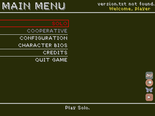
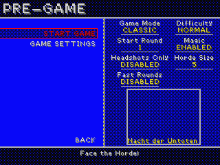
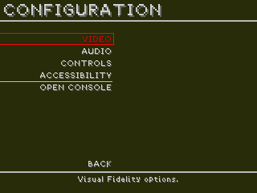
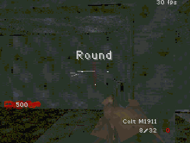

# FroggyZombies (Nazi Zombies: Portable for Data Frog SF2000 & GB300)

**FroggyZombies** is a port of **Nazi Zombies: Portable** (the classic Call of Duty: Zombies de-make built on the Quake / Vril engine) specifically optimized for the **Data Frog SF2000** and **GB300 / GB300V2** handheld consoles.

Enjoy round-based zombie survival on low-cost MIPS32 handhelds with pure soft-float calculations, custom controls, and a smooth 25–30 FPS experience.

---

## Screenshots

| Main Menu | Pre-Game Lobby |
|:---:|:---:|
|  |  |

| Video Options (Resolution Scale) | In-Game Action (Nacht der Untoten) |
|:---:|:---:|
|  |  |

---

## Highlights & Features

- **Pure MIPS32 Soft-Float Engine**: Optimized for Ingenic JZ4725B / XBurst CPUs without hardware FPU (`-msoft-float`, fixed-point transformations).
- **Native 320x240 RGB565 Output**: Direct 16-bit video streaming via libretro interface.
- **In-Game 3D Resolution Scale Slider**:
  - Found under **CONFIGURATION -> VIDEO -> RESOLUTION SCALE**.
  - Adjust 3D world rendering resolution from **50% to 100%** on the fly (press **A** or **D-Pad Left/Right**).
  - Keeps the 2D HUD, ammo counters, crosshair, and menus crystal-clear at native 320x240 while rendering 3D graphics faster to hit a solid **25–30 FPS**!
- **Split Packfile Architecture (<32 MB)**: Bypasses the SF2000/GB300 FAT32 driver 32 MB file seek limitation (`nzp.pak`, `nzp2.pak`, `nzp_sounds.pak`).
- **Complete Gameplay Mechanics**:
  - Rounds, barriers & rebuilding, mystery box with weapons.
  - Perks-a-Cola machines, Power-ups (Max Ammo, Insta-kill, Double Points, Nuke, Carpenter).
  - Hellhound dog rounds, crawler zombies, point scoring.
  - Full sound effects intact (weapons, reloads, zombie groans, announcements).

---

## Quick Installation Guide (Ready to Play)

1. Go to the [Releases](https://github.com/synaps33/froggyzombies/releases) page.
2. Download **`froggyzombies-v1.0.0-sd.zip`**.
3. Plug your handheld console's MicroSD card into your computer.
4. Extract the contents of the ZIP file directly onto the **root** of your SD card.
   - It will place files into `/ROMS/nzp/` and `/system/Deimos/cores/`.
5. Safely eject the SD card and insert it back into your **SF2000** or **GB300**.
6. Turn on the console, navigate to the **ROMS** or **User / GBA** section, and launch **NZPortable**.

---

## Controls

The control layout is tailored for comfortable handheld play:

| Button | Action |
|:---|:---|
| **D-Pad Up** | Walk forward |
| **D-Pad Down** | Walk backward |
| **D-Pad Left** | Strafe left |
| **D-Pad Right** | Strafe right |
| **A Button** | Look right / Confirm menu item |
| **Y Button** | Look left / Cancel menu item |
| **X Button** | Look up |
| **B Button** | Look down |
| **R Trigger** | Shoot / Attack |
| **L Trigger** | Aim Down Sights (ADS) |
| **Select Button** | Use / Interact / Rebuild barriers |
| **Start Button** | Pause menu |

*Tip: When inside the menus, use the D-Pad to highlight an option, and press **A** to select.*

---

## Performance Tips

To get the smoothest performance:
1. From the Main Menu, go to **CONFIGURATION** -> **VIDEO**.
2. Find **RESOLUTION SCALE**:
   - Default is **75%** (great balance of sharpness and speed).
   - Set to **60%** or **50%** for maximum frame rate (steady 30 FPS).
   - You can cycle values by pressing **A** or fine-tune with **D-Pad Left / Right**.
3. Settings are saved automatically upon change and exit.

---

## Building from Source

To compile the core yourself, you need the MIPS toolchain (`mips-mti-elf`):

```bash
# Build the libretro static core for SF2000 / GB300
make sf2000

# Or build the native Linux shared library for PC testing
make
```

To create the final `.gb3k` / `.sf2k` multicore executable, link `nzp_libretro_sf2000.a` with the SF2000 multicore wrapper:
```bash
make -C sf2000_multicore FROGGY_TYPE=GB300V2 CORE=path/to/nzp_core
```

---

## Credits & License

- **Nazi Zombies: Portable Team**: Original NZ:P project, assets, and QuakeC implementation.
- **Id Software**: Original Quake engine code.
- **Data Frog / GB300 Port & Optimization**: Synaps33 & OpenCode contributors.

Licensed under the GNU General Public License (GPLv2).
